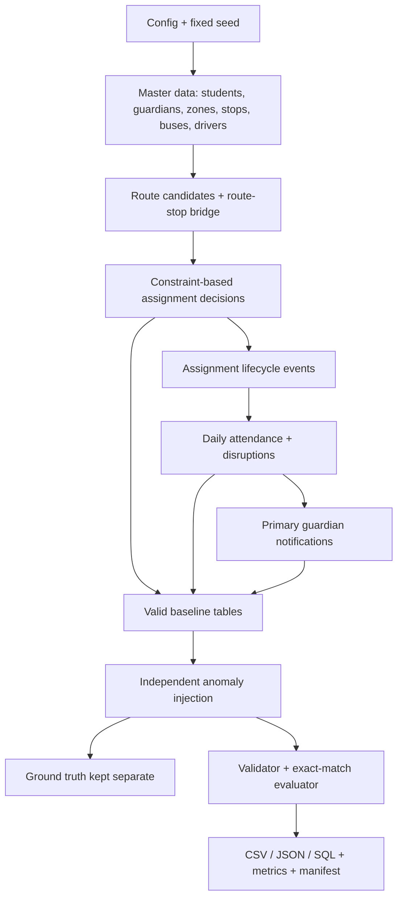

# Reviewer walkthrough

## 90-second demonstration

The current automated regression suite contains **24 tests** (`python -m pytest -q`).

```bash
python -m pytest -q
python -m busroute generate --profile starter
python -m busroute validate --data datasets/starter/data --ground-truth datasets/starter/ground_truth/ground_truth.csv
python scripts/verify_sqlite_seed.py --seed datasets/starter/data/seed.sql
python -m busroute reproduce --profile starter --formats csv,json,sql --out /tmp/busroute-repro
```

Open these five artefacts in order:

1. `datasets/starter/manifest.json` — seed, profile, row counts, environment, quality gate and file hashes.
2. `datasets/starter/metrics.json` — assignment coverage, route/fleet utilisation, accessibility and grade/zone coverage, attendance outcomes and privacy exceptions.
3. `datasets/starter/validation_summary.json` — clean baseline, detected post-injection rules, CSV round-trip and SQLite FK integrity.
4. `datasets/starter/ground_truth/ground_truth.csv` — the known injected examples, separated from the input tables.
5. `docs/full_scale_verification.json` — full-profile evidence: clean-baseline validation, exported CSV anomaly scoring, SQLite import/FK results and 35-artifact SHA-256 reproducibility comparison.

For an independent full-scale reproducibility run, use `make reproduce-full`; it runs two separate full builds and compares their manifests.

## Architecture



## Explain the assignment decision

The generator evaluates candidates in a deterministic order. Wheelchair-required students are processed first so a student who needs an accessible vehicle does not lose one of the limited wheelchair positions to a student without that requirement. Candidate stops must be approved and within the walking threshold; wheelchair-required students need an accessible stop and a bus with available wheelchair positions. All students must be inside the 75-minute pickup window and under the bus's seat capacity. The remaining feasible candidates are ranked by walking distance plus a route-load penalty.

Every student receives an assignment row. A student who cannot be assigned is not dropped: `route_id`, `stop_id` and pickup time remain null, while `decision_reason` records the failed constraint. That makes the exception measurable and auditable.

## Explain the event model

`assignments` stores the current school-year decision; `assignment_events` stores the lifecycle transition. `attendance_events` records a daily snapshot of student, assignment, route, stop, school date and status. `route_disruptions` is a dated event, not an overwritten route field. `notifications` records which primary guardian was addressed, which attendance event triggered it, the channel, destination, reason and delivery outcome.

## Explain the five anomalies

The baseline is generated and validated first. The injector then makes a small, documented mutation for each anomaly and writes the expected rule/entity pair to the separate ground-truth files. The ground-truth file is not joined into model inputs. `evaluate.py` compares validator detections with labels and reports precision, recall, false positives, false negatives and unexplained violations.

## Be candid about the current trade-offs

- The route assignment algorithm is a deterministic greedy heuristic, not a global optimisation solver. The fixed-seed full profile reaches 95.62% assignment coverage and wheelchair-required coverage of 96.15% versus 95.61% for other students; the remaining rural coverage gap (86.03%) is reported explicitly.
- Daily disruptions affect attendance and notifications, but they do not trigger a live re-routing service.
- The map geometry is synthetic and planar, not a real street network.
- Capacity validation conservatively counts everyone assigned during the year, including students who later withdraw.
- Coverage by accessibility need, grade band and zone type should be discussed as operational fairness indicators, not hidden behind the overall assignment rate.

## Candidate preparation

Before the interview, personally run the commands above and be able to explain the files in `busroute/generate.py`, `busroute/validate.py` and `busroute/anomalies.py`. In particular, understand why the route score is a heuristic, why the model favours accessible assignments first, why the capacity baseline is conservative, and why assignment-changing injections run before capacity injections.
